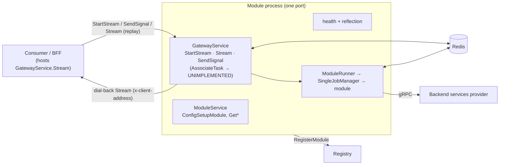
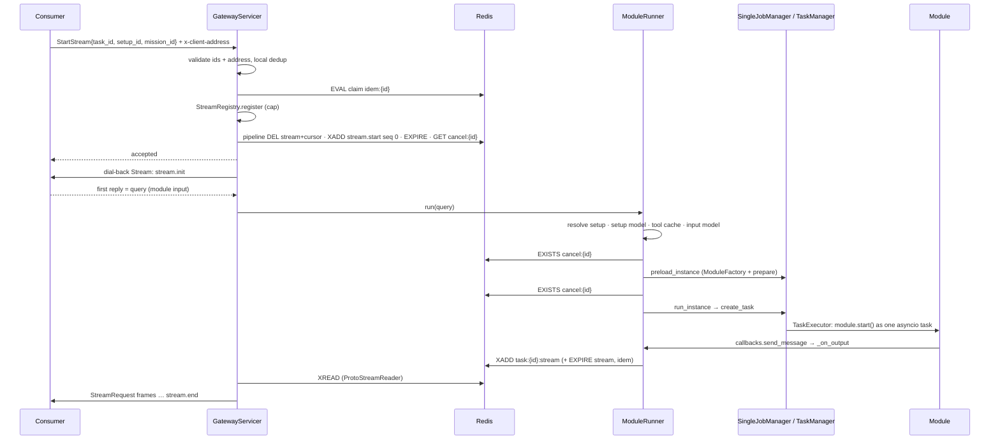
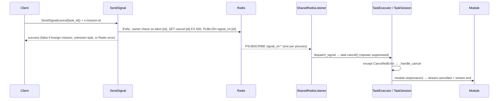

# Architecture

How a DigitalKin module process is built, how one task runs through it, and where state lives.
Wire-level details (messages, sentinels, error codes) are in [Gateway protocol](gateway_protocol.md).
Tuning is in [Operations](operations.md); every variable name is in [Environment variables](environment_variables.md).

## 1. Scope

The SDK is a Python library for building **modules**. Each module runs as one gRPC server process.
That process embeds its own gateway, so there is no standalone gateway process. Redis is required.

| External dependency | Role | SDK side |
|---|---|---|
| Backend "services provider" | Storage, Cost, Filesystem, Setup + SetupVersion, UserProfile (incl. `CheckResourceAccess`, `GetSetupSecret`), `GatewayService.AssociateTask` | gRPC client only (`services/`) |
| Registry service | Module catalogue and search | Client only: `RegisterModule` at start; `deregister()` at stop only logs, entries expire by heartbeat |
| Consumer / BFF | Starts tasks, hosts its own `GatewayService.Stream` endpoint | Passes it in `x-client-address`; the module dials back |
| Redis | Output streams, idempotency, cancel tombstones, signal pub/sub | `core/task_manager/redis/` |
| `agentic-mesh-protocol` package | Proto stubs | Imported as `agentic_mesh_protocol.<svc>.v1` |

## 2. Topology

## 3. Package map (`src/digitalkin/`)

| Package | Contents |
|---|---|
| `modules/` | `BaseModule` lifecycle, `ArchetypeModule`, `ToolModule`, `TriggerHandler`, trigger discovery |
| `models/` | Pydantic models: `DataModel`, `SetupModel`, `ModuleContext`, `ModuleStatus`, settings (`models/settings/`), `StreamErrorCode` |
| `mixins/` | Context helpers for modules: AG-UI (`AgUiMixin`), cost, storage, filesystem, file history, logger |
| `services/` | Strategy per service (local `Default*` vs `Grpc*`), `ServicesConfig`, `GrpcCommunication` (module-to-module) |
| `core/job_manager/` | `SingleJobManager`: preloads and runs module instances in-process, tracks config-setup sessions |
| `core/task_manager/` | `BaseTaskManager` (slots + queue), `LocalTaskManager`, `TaskExecutor`, `TaskSession`, `ModuleRunner` |
| `core/task_manager/redis/` | `RedisClient` (split pools), `ProtoStreamReader`, `RedisIdempotency`, `SharedRedisListener` |
| `core/resilience/`, `core/profiling/` | `Bulkhead`, `log_unhandled`; `StepTimer`, `TaskProfiler` |
| `grpc_servers/` | `ModuleServer`, `ModuleServicer`, `GatewayServicer`, `StreamRegistry`, `M2MCallRegistry` |
| `grpc_servers/interceptors/`, `utils/` | Request-ID, permission and validation interceptors; `GrpcClientWrapper.exec_grpc_query`, `CircuitBreaker`, validators |
| `community/agno/` | Agno adapter: `AgnoStreamAdapter`, HITL runner, `ModuleToolkit`, AG-UI tools |
| `utils/` | Schema helpers, env manager/template, package discovery, proto utils |

## 4. Run flow

1. **Admission** (`gateway_servicer.py:169`). Invalid ids or address → `accepted=false`. A task already in the local registry is refused. The idem claim must return `CLAIMED`; `RECLAIMED`/`TAKEN` are refused.
2. **Capacity.** `StreamRegistry.register` rejects above `DIGITALKIN_GATEWAY_MAX_STREAMS` (20000) and releases the claim.
3. **Seed.** One pipeline drops any stale stream/cursor, writes `stream.start` (seq 0), arms the initial TTL and reads a pre-start tombstone. A tombstone from another mission is deleted (compare-and-delete).
4. **Dial-back.** `_dial_consumer` (`:793`) opens the consumer's `Stream` and sends `stream.init`. The query arrives as the consumer's **first reply** on that bidi, not in `StartStream`. No reply → `DIAL_BACK_NO_QUERY`.
5. **Setup** (`module_runner.py:56`). `ModuleServicer.resolve_setup` calls `CheckResourceAccess`, then the setup cache (TTL, in-flight coalescing), then `SetupStrategy.get_setup`. Then `create_setup_model`, the per-setup tool cache, `create_input_model`. All steps are sequential.
6. **Instance.** `SingleJobManager.preload_instance` builds the module with `ModuleFactory` and runs `prepare()`. `run_instance` calls `LocalTaskManager.create_task`, which acquires a slot and hands `module.start()` to `TaskExecutor` as one asyncio task.
7. **Heartbeat.** `ModuleRunner` writes a liveness frame after `DIGITALKIN_MODULE_HEARTBEAT_INTERVAL_S` (30 s) of silence: an AG-UI state delta, else `stream.heartbeat`.
8. **Output** (`_on_output`, `:152`). Every `send_message` is one pipeline: `XADD {pb, seq}` (approximate `MAXLEN`), plus `EXPIRE` on stream and idem. `stream.end` becomes a single `{eos: true}` entry and shortens both TTLs.
9. **Relay.** The gateway reads with `ProtoStreamReader` (XREAD, 50 entries, 50 ms block) and forwards frames on the dial-back. It always ends with `stream.end`.
10. **Reconnect.** If the bidi dies before `stream.end`, the gateway re-dials the same address with `stream.resume`. The consumer answers with its cursor in `seq`. Retries use jittered backoff (3–5 s) within a 300 s window (`DIGITALKIN_GATEWAY_DIAL_BACK_RECONNECT_*`). The module is never re-run.
11. **Late client.** A consumer may open `Stream` directly; if the session is gone but the Redis stream exists, it is replayed.
12. **No multi-turn input.** Follow-up upstream frames are logged and dropped.

Only `ConfigSetupModule` uses the in-memory session queue. Task output always goes through Redis.

## 5. Cancel and signals

- **Ownership.** The Lua script (`gateway_servicer.py:503`) refuses a cancel when `idem:{id}` belongs to another mission. Nothing is written then. A cancel without `x-mission-id` passes unchecked and is logged.
- **Unknown task.** Without an idem key the tombstone is still written and `success=false` is returned. A later `StartStream` from the same mission honours it.
- **Race with startup.** `ModuleRunner` checks `cancel:{id}` before preload, after preload, and after `run_instance`. A hit emits `stream.cancelled` + `stream.end`, stops the preloaded instance, or cancels the new task.
- **Stop** is a hard cancel; only the recorded `CancellationReason` differs.
- **Invalidate.** `SendSignal(invalidate{scope})` runs the local cache handler for `ALL`, `CHANNELS`, `MODELS`, `SETUP`, `TOOLS` or `SHARED`. `SETUP`/`TOOLS` target the caller's `x-setup-id`. It then publishes on `signal_ch:_global_` with an `origin`; each process skips its own origin.

## 6. Module lifecycle

| Step | What happens |
|---|---|
| `prepare(setup, callback)` | Idempotent. Sets `callbacks.send_message` → builds the tool cache (archetypes only) → `rehydrate_loaded_tools()` → `initialize()` → `init_handlers()` |
| `start(input, setup, callback)` | `prepare()`, then `run()` dispatching on `input.root.protocol` to a `TriggerHandler`; `stop()` in `finally` |
| `stop(cancel_reason)` | Idempotent. `cleanup()`, then `stream.cancelled` (if cancelled) and always `stream.end` |

`TaskSession.cleanup()` calls `module.stop()` before `context.cleanup()`; a second `stop()` is a no-op.

`ModuleStatus` values: `CREATED, STARTING, RUNNING, STOPPING, STOPPED, FAILED, CANCELLED, NOT_FOUND`.
On the run path the module goes `CREATED → STOPPING → STOPPED`, or ends in `CANCELLED`/`FAILED`.
`STARTING` is never assigned. `RUNNING` is only set by `start_config_setup`. Task-level status lives in `TaskSession` (`pending → running → completed | cancelled | failed`).

## 7. Concurrency and admission (per process)

| Limit | Default | Behaviour |
|---|---|---|
| gRPC max concurrent RPCs | `cpu_count × 200` | Server-level gate (`SERVER_MAX_CONCURRENT_RPCS`) |
| Gateway sessions | 20000 | `StreamRegistry` refuses `StartStream` at the cap |
| Task slots | `max_concurrent_tasks` 500 | `asyncio.Semaphore`; tasks run when they hold one |
| Admission gate | slots + `max_queued_tasks` 5000 | Wait `admission_timeout` 5 s, then reject |
| Queue wait | `queue_slot_timeout` 600 s | Admitted task waits this long for a slot |
| Legacy mode | `max_queued_tasks=0` | Single slot wait of `task_wait_timeout` 30 s |
| Signal listener | 10000 tasks | `DIGITALKIN_SIGNAL_MAX_TASKS` |
| M2M outbound calls | 200 | `DIGITALKIN_M2M_CALL_MAX_CONCURRENT` |

Task-manager variables use the `DIGITALKIN_TASK_MANAGER_` prefix (`models/settings/task_manager.py`).

**Redis split pools.** `RedisClient` opens two pools on the same URL (`DIGITALKIN_REDIS_POOL_SIZE` 2000, split 50/50 unless `POOL_SIZE_DEFAULT`/`POOL_SIZE_BLOCKING` are set).
A blocking `XREAD` holds its connection for the block time. On a shared pool, readers would starve `XADD`, `PUBLISH` and pipelines.
The blocking pool retries reads (3, idempotent); the write pool never retries, so an `XADD` is never duplicated.
Both pools use raw bytes, a 15 s connection health check, and are pinged at gateway start; the gateway refuses to start if Redis is unreachable.

## 8. Module-to-module calls

`GrpcCommunication.call_module` (`services/communication/grpc_communication.py:337`):

1. Per-target circuit breaker (`DIGITALKIN_M2M_CALL_BREAKER_*`): open → fail fast.
2. Concurrency slot from `M2MCallRegistry` (wait `CALL_ACQUIRE_TIMEOUT_S`, 30 s).
3. Backend `AssociateTask(parent_task_id)` with an `x-idempotency-key` nonce mints the child `task_id`.
4. The call is registered in `M2MCallRegistry` with the query and an output queue.
5. `StartStream` on the target, advertising this process's own gateway in `x-client-address`.
6. The target dials back into this process's `Stream` with `stream.init`. The gateway sees a known outbound `task_id` and hands the bidi to `M2MCallRegistry.handle_dial_back_receive`. It sends the cached query first, then queues outputs until `stream.end` or a fatal `stream.error`.
7. Each output must arrive within `CALL_TIMEOUT_S` (120 s). A cancelled call sends a best-effort `SendSignal(cancel)`.

## 9. Redis keys

| Key | Type | Written by | TTL (default) | Purpose |
|---|---|---|---|---|
| `task:{id}:stream` | Stream: `{pb, seq}` entries, final `{eos: true}` | `StartStream` (seed), `ModuleRunner._on_output` | 600 s sliding, re-armed per output; 360 s after EOS | Task output; `MAXLEN ~1000` (approximate) |
| `task:{id}:cursor` | String (last entry id) | `ProtoStreamReader`, every 100 entries | 360 s | Gateway read position |
| `idem:{id}` | String `{process_id}\|{mission_id}` | `RedisIdempotency.claim` (Lua) | 3600 s, re-armed per output; 360 s after EOS | At-most-once start; cancel ownership |
| `cancel:{id}` | String (caller mission id) | `SendSignal` (Lua) | `EX 600` | Tombstone for cancels before/around registration |
| `signal_ch:{id}` | Pub/sub channel | `SendSignal` | — | Cancel delivery |
| `signal_ch:_global_` | Pub/sub channel | `SendSignal(invalidate)` | — | Cache-invalidation fan-out |

TTLs come from `DIGITALKIN_GATEWAY_STREAM_REDIS_STREAM_INITIAL_TTL`, `_REDIS_STREAM_TTL`, `_REDIS_CURSOR_TTL`, `_REDIS_STREAM_MAXLEN` and `DIGITALKIN_REDIS_IDEM_TTL`.
The idem key is released when a dial fails before the runner starts, or when the registry is full, so the task can be retried.

## 10. Resilience

| Mechanism | Where | Defaults / variables |
|---|---|---|
| App-level retry | `GrpcClientWrapper.exec_grpc_query` | Retries `UNAVAILABLE`, `INTERNAL`, `DEADLINE_EXCEEDED`; `CLIENT_MAX_RETRIES` 2, `CLIENT_BACKOFF_BASE_MS` 50 (doubling), `CLIENT_TIMEOUT` 30 s |
| Channel retry (gRPC core) | Channel service config | **Off**: `CLIENT_GRPC_OPTIONS_ENABLE_RETRIES=false`; `CLIENT_GRPC_RETRY_*` apply only when enabled |
| Circuit breaker | Per service, inside `exec_grpc_query` | `CLIENT_CIRCUIT_BREAKER_FAIL_MAX` 5, `CLIENT_CIRCUIT_BREAKER_RESET_TIMEOUT` 30 s; `UNKNOWN` and `RESOURCE_EXHAUSTED` also count as failures |
| M2M breaker | Per target `host:port` | `DIGITALKIN_M2M_CALL_BREAKER_FAIL_MAX` 5, `_RESET_TIMEOUT_S` 30 s |
| Bulkhead | `core/resilience/bulkhead.py` | `DIGITALKIN_BULKHEAD_DEFAULT_MAX` 50, `DIGITALKIN_BULKHEAD_TIMEOUT` 2 s, `DIGITALKIN_BULKHEAD_<SERVICE>_MAX`; no call path acquires it today |
| In-band errors | Gateway `Stream` | Never aborts; a fatal error is `stream.error{code, fatal: true}` + `stream.end` |
| Idle guards | Gateway reader / dial-back | `STREAM_IDLE_TIMEOUT` after `read_idle_timeout_s` 300 s; dial-back idle 300 s, lifetime 3600 s |

`StreamErrorCode` (`models/grpc_servers/stream_error_codes.py`): `DIAL_BACK_UNREACHABLE`, `DIAL_BACK_RPC_ERROR`, `DIAL_BACK_INTERNAL`, `DIAL_BACK_NO_QUERY`, `DIAL_BACK_IDLE_TIMEOUT`, `STREAM_IDLE_TIMEOUT`, `REDIS_UNAVAILABLE`, `MODULE_RUNTIME_ERROR`, `INPUT_VALIDATION_ERROR`, `SETUP_VALIDATION_ERROR`, `BACKPRESSURE_TIMEOUT`, `SETUP_ACCESS_DENIED`.

**Shutdown order** (`ModuleServer.stop_async`): health `NOT_SERVING` → deregister → server stop within `grace` → `job_manager.stop()` (cancels tasks) → gateway stop → Redis client close → registry close → channels close.

## 11. Design trade-offs

| Choice | Cost | Benefit |
|---|---|---|
| Every output goes through Redis | One pipelined round trip per output (`XADD` + 2 `EXPIRE`) | Replay, resume after consumer loss, no output lost on disconnect |
| Gateway reads with blocking `XREAD` | Up to one 50 ms block per poll; one extra hop | Producer and consumer fully decoupled |
| Split Redis pools | Twice the connections | Readers never starve writers |
| Redis is mandatory | Redis outage stops the gateway (no in-memory fallback) | One code path, embedded or deployed |
| Dial-back instead of a response stream | Consumer must host `GatewayService.Stream` | Module can re-dial and resume; same path serves M2M |

Reference run (2026-06-18, 50 workers × 1200 s against a hosted gateway, dial-back over ngrok): transport first byte p50/p95/p99 = 86/145/294 ms over 2,734 calls with 0 failures. Full-call latency (p50 21.5 s) was dominated by the LLM.
